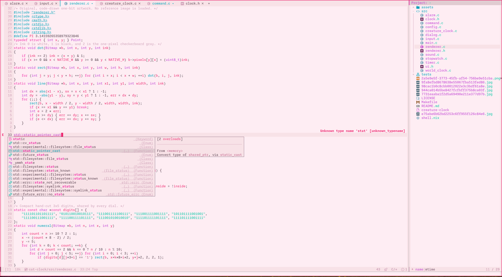
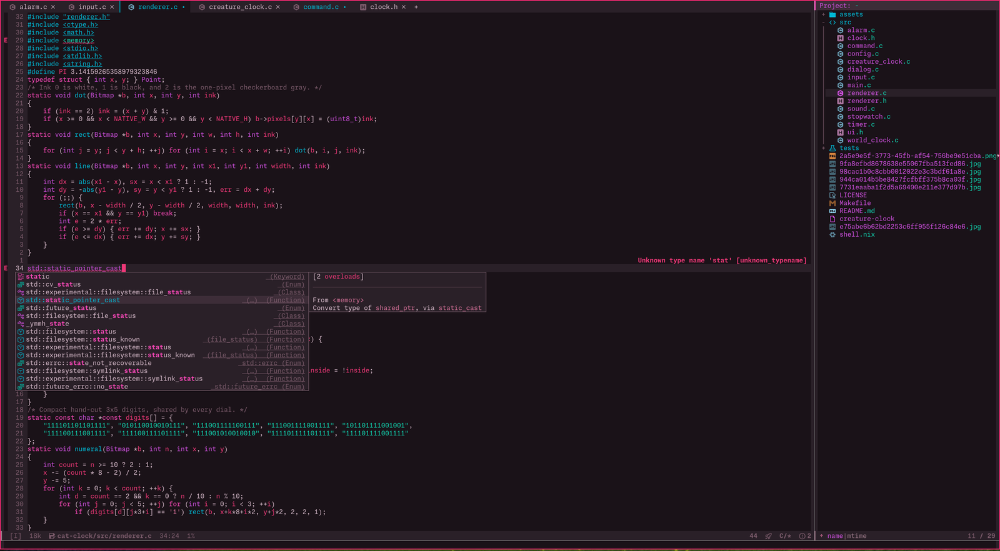
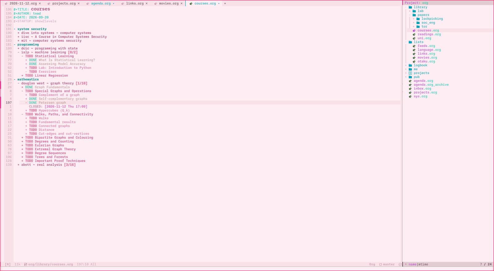
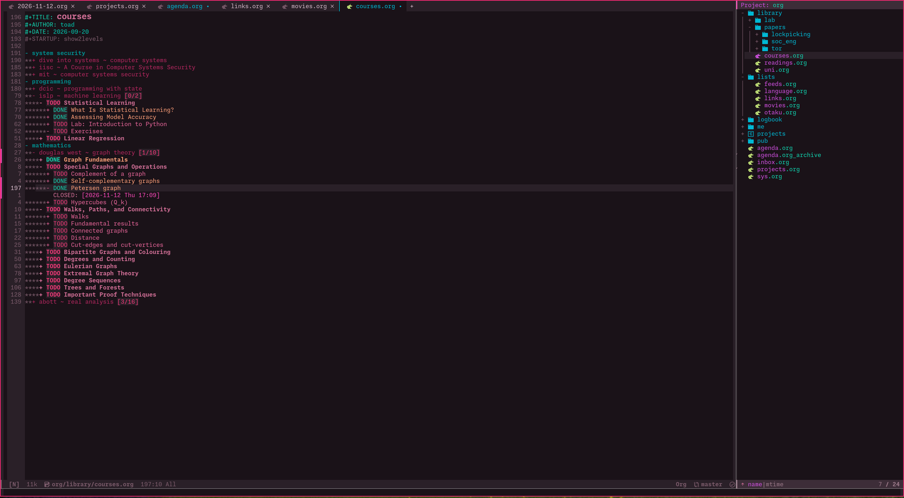

# candy + flip

A pink and teal colour theme for Emacs, in a light and a dark variant, built
on [base16-theme](https://github.com/tinted-theming/base16-emacs).

- **`base16-candy`**: light, candy pink-white background with plum text
- **`base16-candy-flip`**: dark, dark plum background with pale pink text

`M-x flip` switches between them.

Website, with a live preview where you can try every option on your own code:
<https://ro15rend.github.io/p/candy-theme/>

| candy | candy flip |
|-------|------------|
|  |  |
|  |  |

## Features

- one 16-colour palette per theme; base16-theme turns it into faces for
  hundreds of packages
- every text colour reaches at least 4.5:1 contrast against its background
- `low`, `normal` and `high` contrast levels
- pink or teal accent for the cursor, links, prompts, search and parens
- bold, italic or underline per token type
- inverse-video or plain region, flat or boxed mode line
- transparent background in terminal frames
- `M-x flip` (also `M-x candy-toggle`) to switch between light and dark

## Install

Needs Emacs 28.1+ and [`base16-theme`](https://github.com/tinted-theming/base16-emacs) 3.0+.

From a checkout:

```elisp
(package-install 'base16-theme)
(add-to-list 'custom-theme-load-path "/path/to/candy-theme/")
(load-theme 'base16-candy t)   ; or 'base16-candy-flip
```

With use-package:

```elisp
(use-package base16-theme :ensure t)
(use-package candy-common
  :load-path "/path/to/candy-theme"
  :custom
  (candy-accent 'teal)
  :config
  (add-to-list 'custom-theme-load-path "/path/to/candy-theme")
  (load-theme 'base16-candy t))
```

Doom Emacs, in `packages.el`, then `doom sync`:

```elisp
(package! base16-theme)
(package! candy-theme
  :recipe (:host github :repo "ro15rend/candy-theme" :files ("*.el")))
```

and in `config.el`: `(setq doom-theme 'base16-candy)`.

With the Makefile:

```sh
make install PREFIX="$HOME/.emacs.d/themes"   # copy the files; add PREFIX to custom-theme-load-path
make package                                  # build dist/candy-theme-0.2.0.tar
make install-elpa                             # install that tarball with package.el
```

`make install-elpa` takes `PACKAGE_USER_DIR=...` if your packages are not in
`~/.emacs.d/elpa`, and fetches base16-theme from MELPA if it is missing.

## Usage

```elisp
(load-theme 'base16-candy t)       ; light
(load-theme 'base16-candy-flip t)  ; dark
```

`M-x flip` switches between the two. `M-x disable-theme` turns the current
one off. When installed as a package, `flip` is autoloaded; from a plain
checkout it is available once a candy theme has been loaded.

## Options

Set these before `load-theme`. Changing them later with `setopt` or
`M-x customize-group RET candy` reloads the enabled theme.

| option | values | default |
|--------|--------|---------|
| `candy-accent` | `pink`, `teal` | `pink` |
| `candy-contrast` | `low`, `normal`, `high` | `normal` |
| `candy-region-style` | `inverse`, `background` (base02) | `inverse` |
| `candy-mode-line-style` | `flat`, `boxed` (accent border) | `flat` |
| `candy-transparent-background` | `nil`, `t` (terminal frames only) | `nil` |
| `candy-formats` | alist of token to `bold`/`italic`/`underline` | `nil` |

```elisp
(setq candy-accent 'teal
      candy-contrast 'high
      candy-formats '((keyword bold) (comment italic)))
(load-theme 'base16-candy-flip t)
```

Tokens for `candy-formats`: `keyword`, `string`, `function`, `type`,
`constant`, `variable`, `builtin`, `comment`, `preprocessor`, `doc`.

The website's configuration section builds this `setq` for you while you
watch the previews change.

For transparency in graphical Emacs 29+, use the frame parameter instead:
`(set-frame-parameter nil 'alpha-background 90)`.

## Palette

| slot   | candy     | candy flip | main use |
|--------|-----------|------------|----------|
| base00 | `#feedf3` | `#1a1218` | default background |
| base01 | `#f8e2e7` | `#2a2028` | fringe, line numbers, hl-line, org blocks |
| base02 | `#e0ccd1` | `#3d2d38` | mode line, region (background style) |
| base03 | `#816473` | `#927885` | comments, line numbers, shadow |
| base04 | `#745268` | `#aa8e9b` | doc strings, mode line text |
| base05 | `#5c4250` | `#d4b8c8` | default foreground |
| base06 | `#463840` | `#e8d0dc` | inactive tabs, mode line emphasis |
| base07 | `#352930` | `#f5e8ef` | brightest foreground |
| base08 | `#d12362` | `#f03878` | variables, errors, org TODO |
| base09 | `#a45174` | `#d47098` | constants, warnings, org title |
| base0A | `#ae39bd` | `#d050e0` | types, org code and verbatim |
| base0B | `#057b66` | `#10d4b0` | strings, success, org DONE |
| base0C | `#007a6c` | `#00c8b0` | builtins, teal accent |
| base0D | `#007888` | `#00b8d4` | functions, preprocessor |
| base0E | `#c5278a` | `#f848b8` | keywords, pink accent |
| base0F | `#cb2762` | `#db487b` | rarely used extras |

## Contrast

The colours were picked by eye, then each text colour was mixed toward black
(candy) or white (candy flip) in 2% steps until it reached 4.5:1 against the
background, the WCAG 2 minimum for body text. `candy-contrast` runs the same
step when a theme loads: `high` keeps mixing until each slot reaches a higher
minimum, and `low` mixes toward the background until each slot is under a
maximum.

| slots | low (at most) | high (at least) |
|-------|---------------|-----------------|
| base03 | 3.0 | 5.5 |
| base04 | 4.5 | 7.5 |
| base05 | 6.0 | 11.0 |
| base06 | 7.0 | 12.0 |
| base07 | 8.0 | 13.0 |
| base08–base0F | 4.5 | 6.0 |

In a terminal, base16-theme uses the terminal's own colours unless
`base16-theme-256-color-source` is `'colors`, so the contrast levels only show
in graphical frames or with that setting.

## Package layout

```
candy-common.el             options, contrast math, face overrides, flip
base16-candy-theme.el       light theme and its palette
base16-candy-flip-theme.el  dark theme and its palette
candy-theme-pkg.el          ELPA package description
Makefile                    check, install and package targets
screenshots/                images for this README
```

## Development

```sh
make check     # byte-compile with warnings as errors, then load both themes
make package   # build dist/candy-theme-$VERSION.tar
make clean     # remove dist/ and *.elc
```

`make check` finds base16-theme through package.el. If it lives elsewhere,
for example in a straight or Doom checkout, pass `BASE16_DIR=/path/to/base16-emacs`.

## Credits

Faces are generated by [base16-theme](https://github.com/tinted-theming/base16-emacs)
from the Tinted Theming project.

## License

[MIT](LICENSE)
